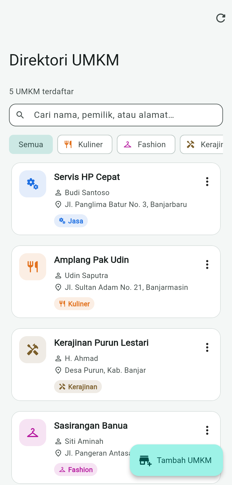
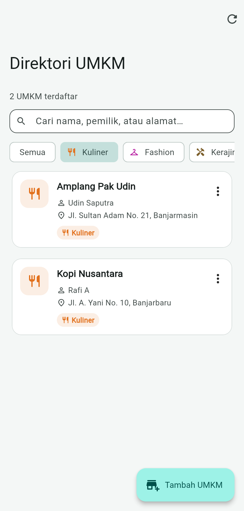
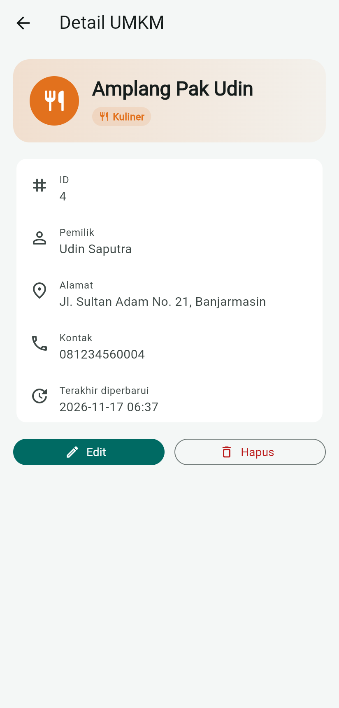
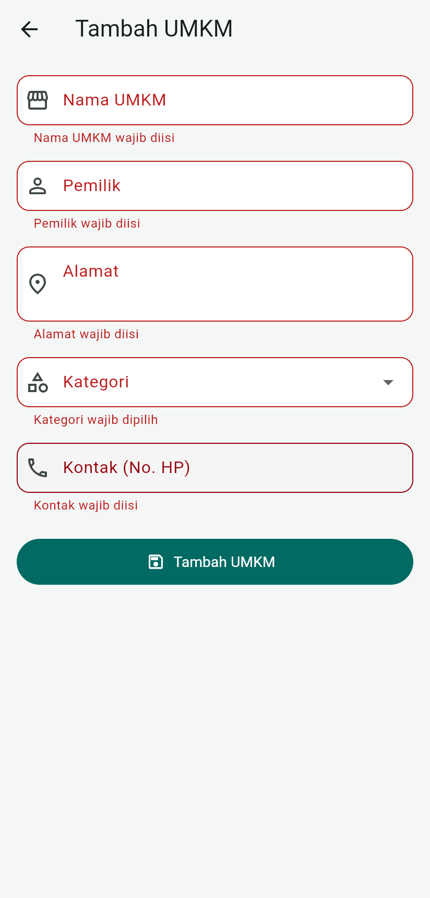
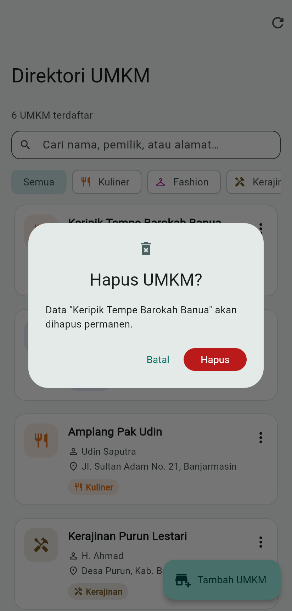

# REST API UMKM (CodeIgniter 4) + JSON Parsing di Flutter

Tugas Topic 10 — REST API & JSON Parsing. Repository ini monorepo berisi dua proyek:

| Folder | Isi |
|---|---|
| [`backend/`](backend) | REST API CRUD UMKM dengan **CodeIgniter 4.7** (`ResourceController`, Model + validasi, migration & seeder, CORS, OpenAPI/Swagger UI) |
| [`frontend/`](frontend) | Aplikasi **Flutter** "Direktori UMKM" yang mengonsumsi API memakai package `http` dan parsing JSON ke model class (`fromJson` / `toJson`) |
| [`docs/screenshots/`](docs/screenshots) | Hasil capture test API dan tampilan aplikasi |

## Endpoint

Base URL: `http://localhost:8080/api`

| Method | Endpoint | Keterangan | Status sukses |
|---|---|---|---|
| GET | `/umkm` | Daftar UMKM. Query opsional: `page`, `per_page`, `search`, `kategori` | 200 |
| GET | `/umkm/{id}` | Detail UMKM | 200 / 404 |
| POST | `/umkm` | Tambah UMKM (body JSON) | 201 / 400 |
| PUT | `/umkm/{id}` | Perbarui UMKM (body JSON) | 200 / 400 / 404 |
| DELETE | `/umkm/{id}` | Hapus UMKM | 200 / 404 |

Body POST/PUT:

```json
{
  "nama_umkm": "Kopi Nusantara",
  "pemilik": "Rafi A",
  "alamat": "Jl. A. Yani No. 10, Banjarbaru",
  "kategori": "Kuliner",
  "kontak": "08123456789"
}
```

`kategori` harus salah satu dari: `Kuliner`, `Fashion`, `Kerajinan`, `Jasa`, `Pertanian`, `Lainnya`.

Format response mengikuti base response di materi:

```json
{ "success": true, "message": "Data UMKM berhasil diambil", "data": [ ... ],
  "meta": { "page": 1, "per_page": 10, "total": 5, "total_pages": 1 } }
```

```json
{ "success": false, "message": "Gagal menambahkan data UMKM",
  "errors": { "nama_umkm": "Nama UMKM wajib diisi", "kategori": "Kategori tidak valid" } }
```

## Menjalankan backend

Butuh PHP 8.2+ (ekstensi `intl`, `mbstring`, dan `sqlite3` atau `mysqli`) dan Composer.

```bash
cd backend
composer install
cp .env.example .env        # default memakai SQLite (writable/umkm.db)
php spark migrate
php spark db:seed UmkmSeeder
php spark serve             # http://localhost:8080
```

Pakai MySQL/MariaDB (XAMPP/Laragon): buat database `db_umkm`, lalu di `.env` ganti blok SQLite dengan blok MySQL yang sudah disediakan (dikomentari), kemudian jalankan `migrate` dan `db:seed` lagi.

Alat bantu test yang ikut disediakan:

- Swagger UI: <http://localhost:8080/docs/> (spesifikasi di `public/openapi.json`)
- Test console: <http://localhost:8080/tester/> menjalankan 8 skenario test (`#1` … `#8`)

## Menjalankan Flutter

```bash
cd frontend
flutter pub get
flutter run -d chrome                     # web, API di http://localhost:8080/api
flutter run                               # emulator Android otomatis memakai http://10.0.2.2:8080/api
flutter run --dart-define=API_BASE_URL=http://192.168.1.10:8080/api   # HP fisik di jaringan yang sama
```

Fitur: daftar UMKM dengan infinite scroll (pagination dari `meta`), pencarian, filter kategori, pull-to-refresh, detail, tambah/edit dengan validasi lokal dan error validasi dari server per field, hapus dengan konfirmasi, serta penanganan error koneksi/timeout.

Struktur `lib/`:

```
lib/
├── config/api_config.dart       # base URL & timeout
├── models/umkm.dart             # model + fromJson/toJson
├── models/api_response.dart     # base response generic + PaginationMeta
├── services/umkm_service.dart   # semua request http + ApiException
├── screens/                     # list, detail, form
└── widgets/kategori_style.dart  # warna/ikon kategori
```

## Screenshot

| List | Filter | Detail | Validasi | Hapus |
|---|---|---|---|---|
|  |  |  |  |  |

Test API: lihat [`docs/screenshots/api-1.png`](docs/screenshots/api-1.png) sampai `api-8.png`.
